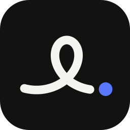

<p align="center">
  
</p>

<h1 align="center">Loop</h1>

<p align="center"><b>Tap start. Stop. It's saved.</b><br>
A private, minimal workout tracker for iPhone. Hold to stop and the workout is saved and named for you.<br>
No forms, no account, no server, no subscription.</p>

---

- Runs, walks and rides with just an iPhone, including run-walk-run (walk breaks are detected and drawn as dots)
- Checks what your devices can measure before you start; if it can't track an activity (a swim without an Apple Watch, say), it tells you and offers a check-in
- Names workouts from where you went: "Saadiyat run", "Kite Beach sunrise loop"
- Saves to Apple Health; everything else stays on the phone
- Two tones and one accent colour

## Layout

- `design/loop.html`: the clickable concept the app is built from
- `app/`: the iOS app (SwiftUI, SwiftData, Core Location, Core Motion, HealthKit, MapKit)

## Build

Requires Xcode 26 and [XcodeGen](https://github.com/yonaskolb/XcodeGen).

```sh
cd app
xcodegen generate
open Loop.xcodeproj
```

Run the tests on a simulator:

```sh
xcodebuild -project Loop.xcodeproj -scheme Loop -destination 'platform=iOS Simulator,name=iPhone 17 Pro' test
```

In Debug builds, launch with `-LoopReplayRoute -LoopReplaySpeed 30` to replay a bundled run around Kite Beach instead of using live GPS.
